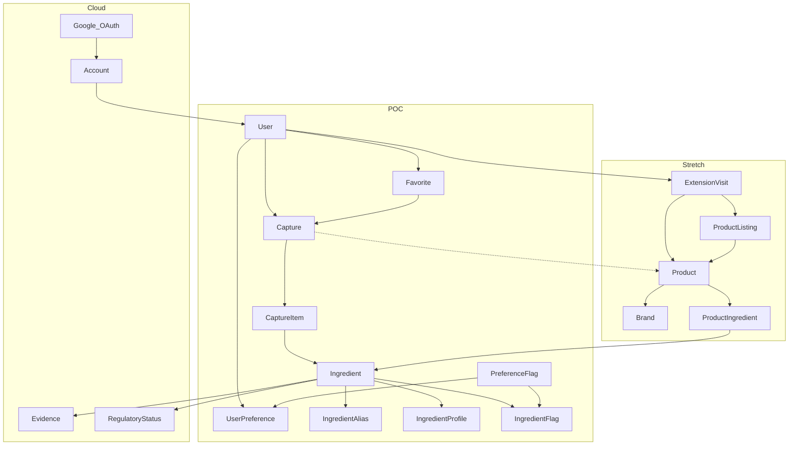

# Data model — phased schema

Field contract for Ingredia, as **legal subsets**: POC local, then cloud additions, then stretch additions. Do not implement the stretch graph in the first migration.

When to build each subset, done-when, and Prisma **sequencing** (squash until first Azure `migrate deploy`, then append-only) are in [development-phases.md](./development-phases.md). This file does not contain migration SQL, Auth.js wiring, OCR, or the extension UI.

Later implementation uses Postgres + Prisma. Image **blob names** live in the database; bytes live in Azurite (POC / local stretch work) or Azure Blob (cloud). Do not store blob URLs as identity. See ADR-0006 on the `template` branch.

One Postgres schema, additive models. Cloud and stretch **add** tables and columns. They do not replace `User` or `Capture`.

## Phase ownership

| Table / columns | Phase |
|---|---|
| `User`, `PreferenceFlag`, `UserPreference` | POC |
| `Ingredient`, `IngredientAlias`, `IngredientProfile`, `IngredientFlag` | POC |
| `Capture` (camera fields), `CaptureItem`, `Favorite` | POC |
| `Account` (Session / VerificationToken as infra) | Cloud |
| `Evidence`, `RegulatoryStatus` | Cloud |
| `Brand`, `Product`, `ProductIngredient`, `Retailer`, `ProductListing` | Stretch |
| `ExtensionVisit` | Stretch |
| Capture `page_url`, `retailer_id`, `product_id`; writing `source = extension` | Stretch |

POC must not create unused listing/visit tables “so we don’t migrate later.”

## Shared vs private

Private tables always filter `WHERE user_id = currentUser`. A user never lists, reads, or favorites another user’s captures.

`user_id` on Capture is **required ownership**, not uniqueness. One user has many captures. Two people scanning the same bottle get two Capture rows. They share the same Product **when that table exists** (stretch) and a match exists.

| Shared catalog | Private to one `user_id` | From phase |
|---|---|---|
| PreferenceFlag | User, UserPreference | POC |
| Ingredient, aliases, profile, ingredient flags | Capture, CaptureItem, Favorite | POC |
| Evidence, RegulatoryStatus | Account | Cloud |
| Brand, Product, ProductIngredient, Retailer, ProductListing | ExtensionVisit | Stretch |

Do not store passwords, age, `google_id` on User, goal-id arrays, or blob URLs.

**Invariant across all three phases:** Favorite always points at a Capture the user owns. It never points at a live Product BOM.

---

## POC local

Stub `User`, camera Capture, alias match, preference flags, Favorite. Local Postgres + Azurite. No Google, no Product, no extension tables.

### Flows

**Camera:** always write a Capture; fill `blob_name`; OCR or pasted tokens become CaptureItems. There is no `product_id` column yet.

**Favorites page:** `Favorite JOIN Capture WHERE favorite.user_id = currentUser`, then that Capture’s CaptureItems. CaptureItem is never inserted into Favorite.

### User

Auth.js-shaped so cloud can add `Account` instead of replacing this row. POC uses a stub user. No `Account`, no passwords, no Google client IDs.

- `id`
- `name`
- `email` unique, nullable
- `emailVerified`
- `image`
- timestamps

### PreferenceFlag

Not free-text goals. Named bundles (“acne-safe grocery”) can later be a Goal that points at many flags. Out of scope.

- `id`
- `code` unique (`gluten`, `sulfate`, `fragrance_allergen`, `comedogenic`, `animal_derived`, …)
- `label`
- `category_scope` nullable (`beauty` / `food` / `household` / null = all)

### UserPreference

Primary key `(user_id, flag_id)`. Replaces storing goal ids on the user.

### Ingredient

Canonical row that aliases, flags, capture lines, and (in stretch) BOM lines all use. Typo tolerance is search on `IngredientAlias.normalized` (Postgres `pg_trgm`), not a table of misspellings.

- `id`
- `slug` unique
- `display_name`

### IngredientAlias

- `ingredient_id` → Ingredient
- `name`
- `name_type`: `common` | `inci` | `iupac` | `cas` | `e_number` | `brand_trade`
- `normalized` (lowercase, punctuation stripped, ASCII-folded)

Unique `(ingredient_id, normalized, name_type)`. **Not** globally unique: the same string may map to two ingredients (ambiguous match).

### IngredientProfile

1:1 with Ingredient. Short blurb for a matched line. Jurisdiction-specific law does **not** live here (that is cloud `RegulatoryStatus`).

- `origin_summary` (plant / synthetic / animal / mineral / mixed)
- `manufacturer_use`
- short plain-English summary

### IngredientFlag

`(ingredient_id, flag_id)` plus optional `product_category` so comedogenic can apply on beauty and not on soup. Category-scoped meaning still matters before listings exist.

### Capture

Immutable snapshot of what this user saw that day. POC fields only:

- `id`
- `user_id` → User, **required** owner
- `source` — written as `camera` only in this phase
- `status`: `uploaded` | `extracted` | `parsed` | `failed`
- `blob_name` nullable — blob key like `<captureId>/<filename>`, **not** a URL
- `raw_text`
- timestamps

`user_id` is not unique. Do not add `page_url`, `retailer_id`, or `product_id` yet.

For Prisma `source`, store a string, or include `extension` in the enum from day one and do not write it until stretch. A POC enum of only `camera` makes stretch an awkward Postgres `ALTER TYPE`.

### CaptureItem

- `capture_id` → Capture
- `raw_token`
- `sort_order`
- `ingredient_id` nullable → Ingredient
- `match_status`: `matched` | `unknown` | `ambiguous`

Unique `(capture_id, sort_order)`. Ambiguous alias: two ingredients share a normalized name → `ambiguous`, `ingredient_id` null until resolved. Nested `fragrance` / `flavor` stay one Ingredient. And/or lines and hyphenation stay in `raw_token`; matching is best-effort.

### Favorite

Primary key `(user_id, capture_id)`. Both FKs required.

**Invariant:** `Favorite.user_id` = `Capture.user_id`.

Favoriting writes **one** Favorite row pointing at the Capture. Unfavorite deletes that row; CaptureItems are untouched. Two captures of the same bottle on different days can both be favorited (`capture_id` is the pin). Cross-user favorite is rejected even if the label looks the same.

### POC delete behavior

- User deleted → UserPreference, Captures, Favorites **cascade**.
- Ingredient deleted → **restrict** if any CaptureItem references it.
- Capture deleted → CaptureItems and Favorites cascade. The blob object is **not** auto-deleted (orphan in Azurite).

### POC seed

A handful of ingredients, aliases, flags, and profiles — enough to demo gluten / fragrance / comedogenic. Put this in `prisma db seed`, not in SQL migrations.

---

## Cloud additions

Same camera tables. Real identity, Azure storage, encyclopedia depth. No Retailer, Product, listings, or ExtensionVisit. There is still no `product_id` column on Capture.

### Account

OAuth link (Auth.js-style). Unique `(provider, providerAccountId)`. Google is `provider = "google"`. This is the only Google-account modeling required.

Auth.js also expects Session and VerificationToken when login is wired. Those are infra, not domain. Do not add a `password` column instead. Do not put `google_id` on User.

### Evidence

1:N on Ingredient.

- `ingredient_id` → Ingredient
- `summary`
- `source_url`
- `published_on`
- `claim_type`: `safety` | `function` | `controversy`

### RegulatoryStatus

1:N. One ingredient, many countries. Legal in US and restricted in EU is two rows, not one string on the profile.

- `ingredient_id` → Ingredient
- `jurisdiction` (`US` | `EU` | `CA` | …)
- `status_text`
- `as_of_date`

### Cloud delete behavior

- User deleted → Account, UserPreference, Captures, Favorites **cascade**.
- Deleting Account (Google unlink) must **not** require deleting User or captures unless the user deletes the account.
- Ingredient deleted → **restrict** if any CaptureItem references it. (`ProductIngredient` does not exist yet.)
- Capture deleted → CaptureItems and Favorites cascade. Blob object is **not** auto-deleted (orphan in Azure Blob or leftover Azurite).

---

## Stretch additions

Extension as a second client. Product catalog, listings, visit diary. Capture gains intake columns. Brand formulations are products + bill of materials, never extra columns on IngredientAlias. Current formula only — no `ProductRevision` in this pass.

Localhost + Azurite is valid while building. Cloud hosting is not a prerequisite for content scripts.

### Flows

**Extension overlay (known listing):** URL matches ProductListing → load Product BOM → overlay IngredientFlag against UserPreference → insert or debounce **ExtensionVisit**. Do not copy the BOM into CaptureItems.

**Extension overlay (unknown page):** parse the page into Capture + CaptureItems **and** insert ExtensionVisit (`capture_id` set). Promotion to Product is a later editorial/pipeline step.

**Save / favorite:** requires a Capture. Scanner: Capture already exists → insert one Favorite row. Extension on a known listing: materialize a Capture (freeze ProductIngredient or the parsed page into CaptureItems) → insert Favorite → set ExtensionVisit.capture_id if this visit created it.

**Camera:** unchanged, except `product_id` may exist and is usually null. Fill `blob_name`; leave `page_url` null.

**Favorites page:** unchanged — still `Favorite → Capture → CaptureItem`. In this phase a user favorites their own Capture of a Product, not the Product row.

### Brand

- `id`
- `name`
- `slug` unique

### Product

- `id`
- `brand_id` → Brand
- `name`
- `slug` unique
- `category`: `food` | `skincare` | `cosmetics` | `household`

### ProductIngredient

- `product_id` → Product
- `ingredient_id` → Ingredient
- `sort_order`
- `raw_label` (how it appears on pack)
- `concentration_text` nullable

Unique `(product_id, sort_order)`. The same ingredient twice on one INCI list is allowed via different `sort_order`.

The Product BOM is the latest known formula. CaptureItem is what was on the label/page that day. Those two will disagree after reformulation; that is expected. Do not rewrite old captures when a formula changes.

### Retailer

- `id`
- `code` unique (`amazon`, `sephora`, `target`, `ulta`)

### ProductListing

How the extension finds a known product. Match via listing, not title string equality.

- `product_id` → Product
- `retailer_id` → Retailer
- `url` unique
- `external_id` nullable (ASIN, etc.)
- `scraped_at`

Unique `(retailer_id, external_id)` where `external_id` is present. Listings are optional; Capture still works without `product_id`.

### Capture (added columns)

Nullable additions. Camera rows stay valid without them.

- `page_url` nullable
- `retailer_id` nullable → Retailer
- `product_id` nullable → Product
- `source` may now be written as `extension`

No global unique on product or url. Extension: write a Capture when there is no listing or when the user saves/favorites. Do not write a full Capture on every known-listing overlay.

### ExtensionVisit

Diary of overlays. Google Account does not store history. Product is the catalog. History is rows the extension inserts.

Query: `WHERE user_id = ? ORDER BY occurred_at DESC`.

- `id`
- `user_id` → User
- `occurred_at`
- `page_url`
- `retailer_id` nullable → Retailer
- `product_id` nullable → Product
- `listing_id` nullable → ProductListing
- `capture_id` nullable → Capture
- `hit_flag_count` — how many of this user’s flags fired

Application debounce (not a primary key): one visit per `(user_id, page_url)` per 15 minutes — update `occurred_at` / bump `hit_flag_count` instead of inserting.

Signed-out overlays create no server row (the extension may keep a local queue). History starts after Google sign-in. A local stretch spike against a stub user may write visits for that stub; that is not signed-out.

### Stretch delete behavior

- User deleted → Account, UserPreference, Captures, ExtensionVisits, Favorites **cascade**.
- Ingredient deleted → **restrict** if any ProductIngredient or CaptureItem references it.
- Product deleted → ProductIngredient and ProductListing cascade; Captures and ExtensionVisits set `product_id` / `listing_id` null (keep diary and snapshots).
- Capture deleted → CaptureItems and Favorites cascade; ExtensionVisit.capture_id set null. Blob is **not** auto-deleted.

### Stretch-only edge cases

- **Two listings, one product:** Amazon title ≠ Sephora title; match via ProductListing.
- **No listing yet:** extension writes Capture + CaptureItems and ExtensionVisit.
- **Known listing, no save:** ExtensionVisit only. No snapshot to favorite until the user saves.
- **Tab refresh spam:** debounce ExtensionVisit as above.
- **Favorite then reformulation:** CaptureItems stay frozen; live Product BOM may differ. That is why save materializes a Capture.
- **OCR vs stored BOM disagree:** keep both; UI can warn. Capture wins for “what did I just see.”
- **Regional SKUs / private label:** different Product rows unless the formula is known to be the same.

---

## Out of scope

Migration SQL, Auth.js wiring, OCR implementation, the extension UI, named goal bundles, formulation version history (`ProductRevision`), pack-shot images on products, and exploding nested `fragrance` / `flavor` bags.

Prisma **sequencing** is in [development-phases.md](./development-phases.md). Exact migrations live in `prisma/migrations` when implementation starts.

## Schema risks

- A globally unique alias constraint will hide collisions; keep aliases unique per ingredient only.
- Skipping `ProductRevision` means the catalog will be wrong after a reformulation; captures stay correct.
- Favoriting a known listing without materializing a Capture would pin a live BOM that mutates.
- `ExtensionVisit` without debounce will flood history.
- Product matching (deduping Amazon vs Sephora) can dominate if listings are built before the camera loop works. Capture always works without `product_id`.
- Blob orphans: DB row gone, blob object remains, in Azurite and Azure Blob.
