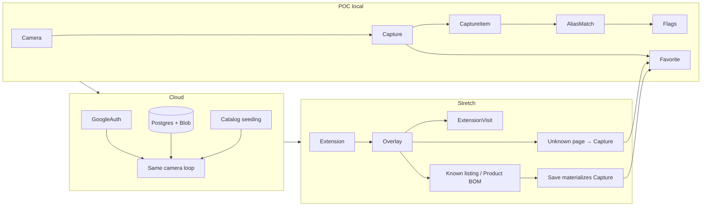
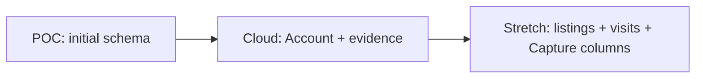

# Development phases

How Ingredia is built against the phased field contract in [data-model.md](./data-model.md): **POC local**, then **cloud**, then **stretch**.

This document is the delivery contract (when, done-when, Prisma sequencing). Field lists, delete rules, and edge cases stay in the data model, grouped as POC / cloud additions / stretch additions. Do not implement the stretch graph in the first migration.

Later implementation uses Postgres + Prisma. Image **blob names** live in the database; bytes live in Azurite (POC / local stretch work) or Azure Blob (cloud). Do not store blob URLs as identity.

## Intent

Camera + matching first. Make that app real in the cloud second. Browser extension last, as a second client of the same API.

Cloud is not a new product. It is the same Capture loop with real identity, real storage, and a real ingredient catalog.

Hosting and the extension are not the same gate. Stretch tables and content scripts can run against localhost + Azurite. Cloud is when the **camera** product is shareable, not when extension work may start.

**Invariant across all three phases:** Favorite always points at a Capture the user owns. It never points at a live Product BOM.

## Cross-cutting rules

- One Postgres schema, additive models. Do not start a second Prisma schema for cloud or stretch.
- Private tables always filter `WHERE user_id = currentUser`. A user never lists, reads, or favorites another user’s captures.
- `user_id` on Capture is required ownership, not uniqueness. Two people scanning the same bottle get two Capture rows.
- Persistence for the camera app is the server (Postgres + blob store), not browser `localStorage`.
- The only justified client queue is unsigned extension overlays in stretch.
- Named goal bundles, `ProductRevision`, pack-shot images on products, and implementation of Prisma/Auth.js/OCR/extension UI are out of scope for this pass of the schema. Prisma **sequencing** is in scope here; migration SQL is not.

## Table ownership

| Table / concern | POC local | Cloud | Stretch |
|---|---|---|---|
| `User` (Auth.js-shaped, stub row) | own | keep | keep |
| `PreferenceFlag`, `UserPreference` | own | keep | keep |
| `Ingredient`, `IngredientAlias`, `IngredientFlag`, `IngredientProfile` | own | keep | keep |
| `Capture` (camera), `CaptureItem`, `Favorite` | own | keep | keep |
| `blob_name` → Azurite | own | — | local dev OK |
| Auth.js `Account` (Session / VerificationToken as infra) | no | own | keep |
| Azure Postgres + Azure Blob, HTTPS, isolation | no | own | keep |
| Encyclopedia seed/curation beyond a demo set | tiny seed | own | keep |
| `Evidence`, `RegulatoryStatus` | no | own | keep |
| `Brand`, `Product`, `ProductIngredient` | no | no | own |
| `Retailer`, `ProductListing` | no | no | own |
| `ExtensionVisit` | no | no | own |
| Capture `page_url`, `retailer_id`, `product_id`; `source = extension` | no | no | own |
| Chrome extension / Web Store | no | no | own |

POC must not create unused listing/visit tables “so we don’t migrate later.” Cloud and stretch still need migrations (Auth.js, evidence, Capture columns, listings).

---

## POC local — prove the camera loop

**Goal.** One person, on their machine, can go photo → text → matched ingredients → preference badges → favorite, without Google, Azure, or Chrome.

**Runtime.** Local Postgres + Azurite. Database stores `blob_name` (for example `<captureId>/<filename>`), never a URL.

**Auth.** One stub `User` row. No `Account`, no passwords, no Google client IDs. Keep `User` Auth.js-compatible (`id`, `name`, `email` unique nullable, `emailVerified`, `image`, timestamps) so cloud can add `Account` instead of replacing `User`.

### User journey

1. Upload or capture a label image, or paste fixture text if OCR is stubbed.
2. Write `Capture` with `source = camera` and `status` walking `uploaded → extracted → parsed` (or `failed`).
3. Write `CaptureItem` rows from OCR or pasted tokens.
4. Match `raw_token` via `IngredientAlias.normalized` (typo tolerance is `pg_trgm`, not a misspelling table).
5. Overlay `IngredientFlag` against `UserPreference`.
6. Favorite writes **one** `Favorite` row on that Capture. Unfavorite deletes that row only. Favorites page is `Favorite JOIN Capture` then that Capture’s CaptureItems.

**OCR.** Stub first (paste text / known images) so matching and favorites work if OCR is weak. Real OCR may land in this phase without a schema change.

### Capture shape

POC Capture has `id`, `user_id`, `source` (written as `camera` only), `status`, `blob_name`, `raw_text`, timestamps.

Do not add `page_url`, `retailer_id`, or `product_id` yet. Those are stretch intake fields. Adding them in stretch is cheaper than pretending the catalog exists.

For Prisma `source`, either store a string in POC or include `extension` in the enum from day one and do not write it until stretch. A POC enum of only `camera` makes stretch an awkward Postgres `ALTER TYPE`.

### Seed data

A handful of ingredients, aliases, flags, and profiles — enough to demo gluten / fragrance / comedogenic. Not a production encyclopedia. Put this in `prisma db seed`, not in SQL migrations.

### Explicitly not in POC

- Google / Auth.js `Account` (and Session / VerificationToken)
- `Brand`, `Product`, `ProductIngredient`, `Retailer`, `ProductListing`
- `ExtensionVisit`
- `Evidence`, `RegulatoryStatus`
- Extension `source`, overlay debounce, freeze-on-save from a BOM
- Browser `localStorage` as the system of record

**Done when.** A local demo: stub user, image or pasted text, some lines matched, a flag fires, favorite appears via `Favorite → Capture → CaptureItem`.

---

## Cloud — same product, real hosting and catalog

**Goal.** The camera app is usable by real people on the internet. Same domain tables as POC; harder ops and content.

### What this phase owns

- **Identity.** Auth.js-style Google OAuth. `Account` is unique on `(provider, providerAccountId)`; Google is `provider = "google"`. Session and VerificationToken are infra, not domain. No `password` column. No `google_id` on `User`.
- **Storage.** Azure Postgres and Azure Blob. Keep `blob_name` as identity; swap the blob backend. CORS, HTTPS, and credentials replace Azurite’s open local emulator.
- **Isolation.** Enforce `WHERE user_id = currentUser` on private tables. Two users scanning the same bottle still get two Captures.
- **Catalog.** Seeding/curation so the encyclopedia is not five demo rows. This is the real production risk, not the VM.
- **Encyclopedia depth.** `Evidence` and `RegulatoryStatus`. `IngredientProfile` stays the short blurb; jurisdiction-specific law does not live on the profile. US vs EU is two `RegulatoryStatus` rows.
- **Lifecycle.** User delete cascades private rows (and `Account`). Ingredient delete **restricts** if any `CaptureItem` references it. Blobs are not auto-deleted with the row unless a job is added. Deleting `Account` (Google unlink) must not require deleting `User` or captures.

### What does not change

- Camera is still the only intake.
- No `Retailer`, `Product`, listings, or `ExtensionVisit`.
- Favorite still pins a Capture, not a SKU.
- Camera Captures still usually have no `product_id`.

**Done when.** Sign in with Google, upload a label, data survives restart on Azure, user A cannot see user B’s captures or favorites, ingredient pages have more than a stub blurb.

Cloud is not done because the app deployed while the catalog is still a toy.

---

## Stretch — extension as a second client

**Goal.** On a retailer page, overlay flags from the same encyclopedia and preferences. History is a visit diary. Save/favorite still freezes a Capture.

**Runtime.** Localhost + Azurite is valid while building. Cloud hosting is not a prerequisite for content scripts. Chrome Web Store (permissions, review) sits at the end of this phase, not in cloud.

### New tables

| Table | Role |
|---|---|
| `Brand` | Product owner |
| `Product` | Current formula only — no `ProductRevision` |
| `ProductIngredient` | BOM / INCI order + `raw_label` |
| `Retailer` | `amazon`, `sephora`, `target`, `ulta`, … |
| `ProductListing` | How the extension recognizes a known page |
| `ExtensionVisit` | Overlay diary |

`Capture` gains nullable `page_url`, `retailer_id`, `product_id`. `source` may be `extension`. Still no Capture on every known-listing overlay.

Product matching is via `ProductListing`, not title string equality. Listings remain optional; Capture still works without `product_id`.

### Flows

**Known listing:** URL matches `ProductListing` → load Product BOM → overlay `IngredientFlag` against `UserPreference` → insert or debounce `ExtensionVisit`. Do **not** copy the BOM into CaptureItems.

**Unknown page:** parse into Capture + CaptureItems **and** insert `ExtensionVisit` (`capture_id` set). Promotion of that snapshot to `Product` is a later editorial/pipeline step.

**Save / favorite:** requires a Capture. Scanner: Capture already exists → one Favorite row. Extension on a known listing: materialize a Capture (freeze `ProductIngredient` or the parsed page into CaptureItems) → insert Favorite → set `ExtensionVisit.capture_id` if this visit created it.

**Debounce:** one visit per `(user_id, page_url)` per 15 minutes — update `occurred_at` / bump `hit_flag_count` instead of flooding rows. Not a primary key.

**Signed out:** no server visit row. The extension may keep a local queue. History starts after Google sign-in.

**Favorites page:** unchanged — `Favorite JOIN Capture WHERE favorite.user_id = currentUser`, then that Capture’s CaptureItems. CaptureItem is never inserted into Favorite.

### Delete behavior added in this phase

- Product deleted → `ProductIngredient` and `ProductListing` cascade; Captures and ExtensionVisits set `product_id` / `listing_id` null (keep diary and snapshots).
- Capture deleted → CaptureItems and Favorites cascade; `ExtensionVisit.capture_id` set null. Blob is still not auto-deleted.
- Ingredient deleted → **restrict** if any `ProductIngredient` or `CaptureItem` references it.

### Still out after stretch

Named goal bundles, `ProductRevision`, pack-shot images, exploding nested `fragrance` / `flavor` bags.

**Done when.** On at least one retailer, a signed-in user sees an overlay, a visit appears in history, saving creates a Capture that stays frozen if the catalog BOM later changes, and favoriting never pins the live Product.

---

## Prisma migrations

Prisma migrations follow the same additive cut as the tables. They are not a fourth phase. Each phase ships new migrations for the tables it owns. This document does not contain migration SQL.

| Phase | Migrations own | Do not put in migrations |
|---|---|---|
| POC | Initial tables listed above | Stretch tables, Google, Azure, encyclopedia INSERTs |
| Cloud | `Account` (+ Session / VerificationToken), `Evidence`, `RegulatoryStatus`, isolation indexes | A new schema from scratch, blob containers |
| Stretch | Product/listing/visit tables; `ALTER Capture` for page/retailer/product and `source = extension` | Squashing history after cloud exists |

Datasource URL (local Postgres vs Azure) is config, not a migration. One `schema.prisma`. Stretch columns on `Capture` are new fields, not a new Capture table.

### The cloud boundary

Until the first successful `prisma migrate deploy` to Azure, the POC branch may squash, reset, and rewrite migrations. After that, history is append-only.

| | POC | After first cloud deploy |
|---|---|---|
| `prisma migrate dev` | Yes | Local only, to **create** new files |
| `migrate reset` / squash / delete migration folders | Fine | No |
| `prisma migrate deploy` | Not needed | CI / release against Azure |
| `prisma db push` | Optional shortcut | Do not use on Azure |

If POC uses `db push` to move fast, baseline **before** cloud: create a real migration from the POC schema so Azure’s first deploy is `migrate deploy`, not “whatever the laptop pushed.”

### What not to put in migrations

- Ingredient encyclopedias and flag catalogs — seed/curation. Editorial `INSERT`s in migrations will fight the first content change.
- Blob containers and Azurite — infra, not Prisma.
- Stretch tables in the POC initial migration.
- A second Prisma schema for cloud.

Auth.js: POC `User` stays adapter-compatible. Cloud’s migration is “add Account/Session,” not “replace User.” Unlink-Google-without-deleting-User is an application rule plus `Account` onDelete, not a User drop.

---

## Do not steal from a later phase

| If you pull this forward | You pay |
|---|---|
| Full Product / Listing schema in POC | Matching Amazon vs Sephora before OCR/matching works |
| Google OAuth in POC | Cloud Console / redirect setup before the camera loop exists |
| Browser `localStorage` as the database | A rewrite in cloud |
| Extension blocked on Azure | Late learning of DOM / CORS / MV3, which localhost could have taught |
| Cloud with five ingredients | A hosted demo that is not a product |
| Favorite → Product in stretch | Reformulation mutates what the user thought they saved |
| Giant stretch migration in POC | Unused FKs and a fat demo, and you still migrate later for Auth.js and evidence |

## Risks (phased)

- OCR quality can make the POC look like a failure even when matching and favorites are correct — keep the text stub path.
- Product matching (deduping Amazon vs Sephora) can dominate if listings are built before the camera loop works. Capture always works without `product_id`.
- `ExtensionVisit` without debounce will flood history.
- Favoriting a known listing without materializing a Capture would pin a live BOM that mutates.
- Skipping `ProductRevision` means the catalog will be wrong after a reformulation; captures stay correct.
- A globally unique alias constraint will hide collisions; keep aliases unique per ingredient only.
- Blob orphans: DB row gone, blob object remains, in every phase.
