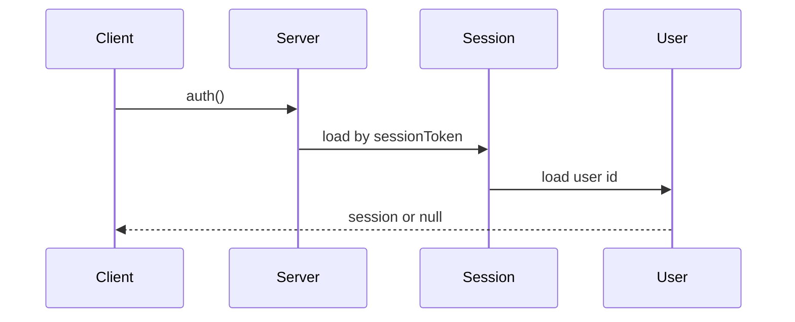
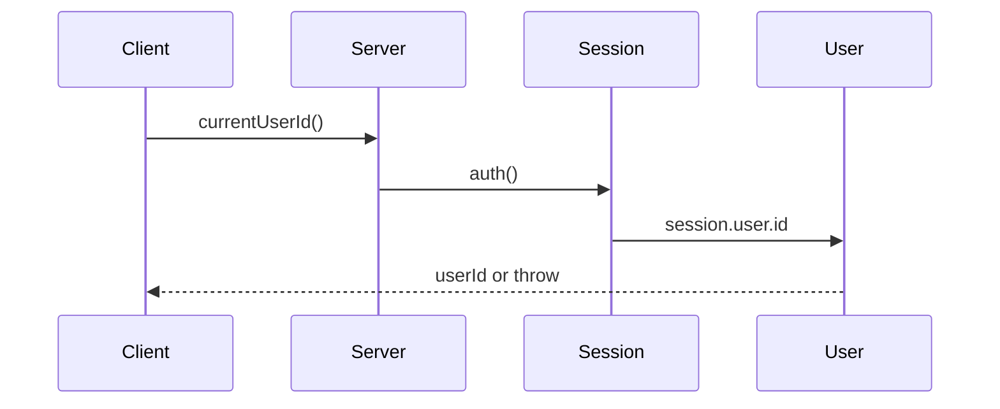
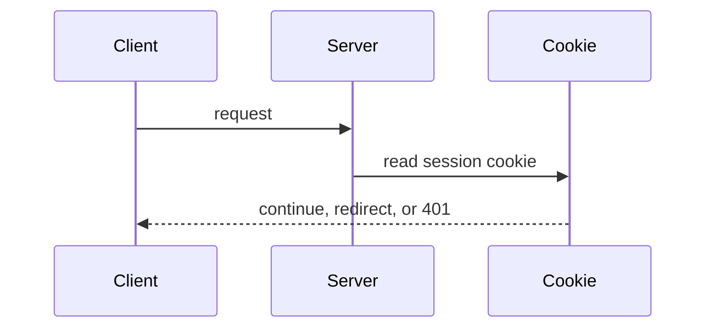
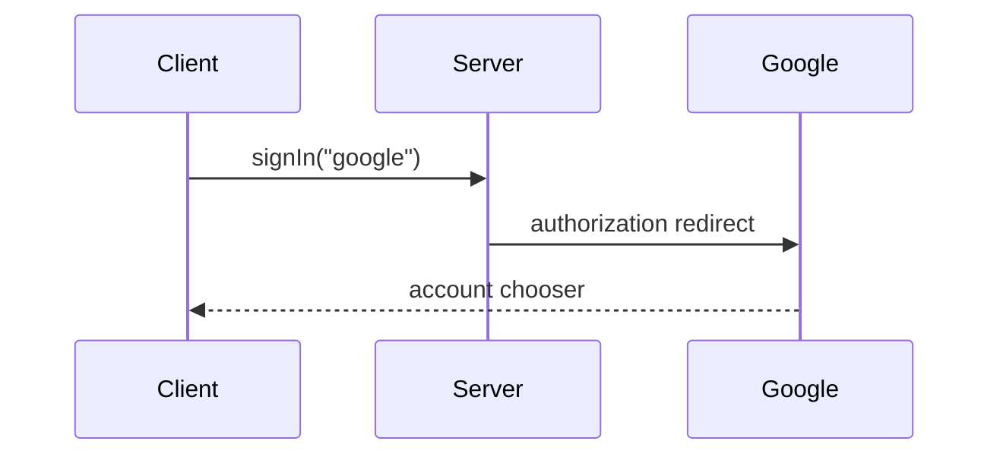
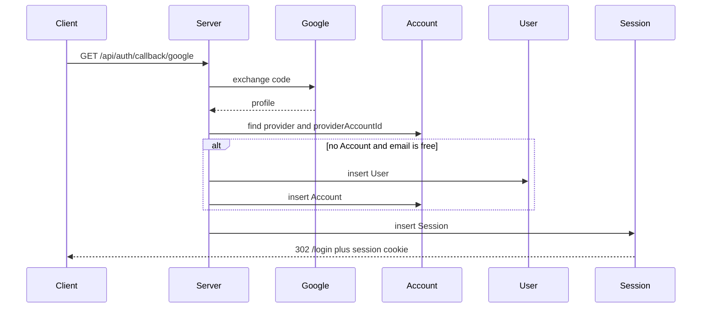
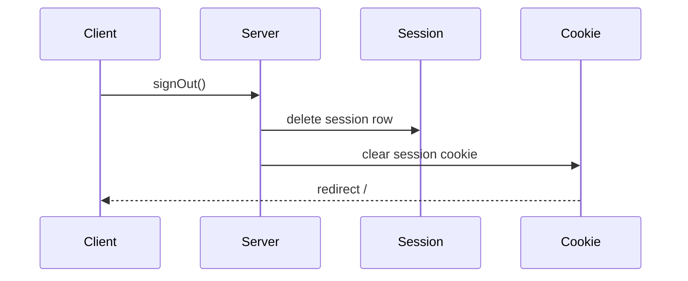
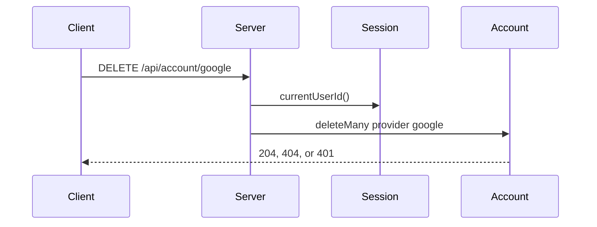
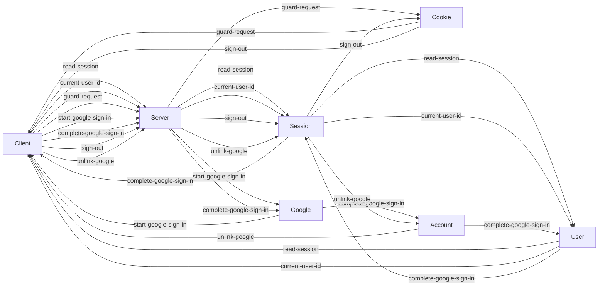

# Identity — Google Auth.js sessions

## Assumptions

- This contract is the identity track only. The label-text stub and the git-reviewed catalog stay outside it.
- `DELETE /api/account/google` with no Google `Account` returns `{ error: { code: "not_found", message: "Google account not linked" } }`.
- Auth.js `pages.signIn` and `pages.error` are both `/login`.

## Problem and non-goals

One feature, slug `google-authjs-sessions`. A signed-in person is the Google database session. `currentUserId()` returns that session's `User.id`. The first Google sign-in creates a `User` and an `Account`. The next sign-in with the same `(provider, providerAccountId)` loads that user. Unlink deletes the Google `Account` and leaves the `User`, the `Session`, and their captures.

`/feature-plan` writes `docs/specs/features/google-authjs-sessions.md` and slices only the operation ids in the API catalog below. A slice's `routes` is a subset of that catalog. An empty `routes` list is only for the migration slice. `/tdd-slice` builds those ids and the files listed under Owns. It does not add a route trace.

### Owns

- `packages/auth`
- `packages/db/prisma/schema.prisma` — `Account`, `Session`, `VerificationToken`, and `User` relations only
- new `packages/db/prisma/migrations/0002_auth.sql` — do not edit `0001_init.sql`
- `apps/web/app/api/auth/[...nextauth]/route.ts`
- `apps/web/app/login/page.tsx`
- `apps/web/app/api/account/google/route.ts`
- `apps/web/middleware.ts`
- `apps/web/app/page.tsx` — signed-out link, sign-out, and unlink around the existing preferences panel
- `apps/migrate/src/seed.ts` — delete the `demo-user` upsert only
- `tests/integration/auth-account.test.ts`
- `.env.example` — names only: `AUTH_GOOGLE_ID`, `AUTH_GOOGLE_SECRET`, `AUTH_SECRET`. Remove the `DEV_USER_ID` line. Do not edit `.env`
- Docs: rewrite `docs/specs/auth.md`; in `docs/specs/phases/cloud-phase.md` remove only the sentence that `auth.md` still says GitHub; update `docs/specs/seams.md`, `packages/auth/README.md`, and the dev-stub pointers in `docs/specs/README.md`, `docs/specs/monorepo.md`, `docs/README.md`, `README.md`, `apps/web/README.md`, `docs/specs/web.md`, `docs/specs/capture/upload.md`, and `docs/specs/capture/read.md`

### Out of scope

Hosting, encyclopedia schema, catalog files, Evidence, RegulatoryStatus, OCR, and any change to capture, favorite, preference, or health handlers. Do not edit `docs/adr/0003-dev-identity-stub.md`, `docs/specs/phases/development-phases.md`, `docs/specs/phases/data-model.md`, or `docs/specs/capture/favorites.md`. No second provider, no email magic link, no `password`, no `google_id`, and `allowDangerousEmailAccountLinking` stays unset. Live redirect URIs and Container Apps copies of the secrets stay on the hosting track.

Existing tests stay green and keep mocking `@project/auth`: `tests/integration/capture.test.ts`, `tests/integration/capture-read.test.ts`, `tests/integration/process.test.ts`, `tests/integration/favorites.test.ts`, `tests/integration/preferences.test.ts`, `tests/integration/smoke.test.ts`.

### Slice order

1. Migration. `routes` empty. Tables `Account`, `Session`, `VerificationToken`.
2. `read-session`, `current-user-id`, and the Auth.js module mounted at `/api/auth/[...nextauth]`.
3. `start-google-sign-in` and `complete-google-sign-in` on `/login`.
4. `guard-request`.
5. `sign-out`, `unlink-google`, the landing states, and removal of the `demo-user` seed.

## Stack

Next.js 15 and React 19 in `apps/web`, TypeScript, Tailwind 4. The server is Next.js route handlers. Identity lives in `packages/auth` and is mounted by the web app. Postgres through Prisma 6 (`@prisma/client` 6.19.3). New dependencies, both on `@project/auth`: `next-auth` 5 and `@auth/prisma-adapter`. Add `@prisma/client` 6.19.3 on that package only if pnpm's peer check requires it.

```bash
pnpm install
pnpm prisma:generate
pnpm dev
pnpm db:seed
pnpm test
pnpm typecheck
pnpm build
```

Tests are Vitest. Integration tests use in-memory PGlite. `pnpm test`, `pnpm typecheck`, and `pnpm build` pass without a Google round-trip. The two-account browser check is manual after `pnpm dev`.

## Runtime

The browser talks to the Next.js server. The server reads and writes Postgres through Prisma. Google is the only third party, and only the sign-in traces call it. Local and production use the same Google client path. The session cookie is `authjs.session-token`, or `__Secure-authjs.session-token` on HTTPS. `AUTH_SECRET` signs the cookie. Google uses `AUTH_GOOGLE_ID` and `AUTH_GOOGLE_SECRET`. Localhost does not require `AUTH_URL`.

## Route traces

### read-session

caller: the server render of `/` and of `/login`
request: in-process `auth(): Promise<{ user: { id: string, name: string | null, email: string | null, image: string | null } } | null>`
handler: Auth.js reads the session cookie, loads `Session` by `sessionToken`, and loads that `User`. A missing, unknown, or expired session returns null and does not throw. `/` when null renders a link to `/login` and does not call `currentUserId()`. `/` when a session exists renders the existing preferences panel, Sign out, and Unlink Google. `/login` when a session exists redirects to `/`.
stages: Client, Server, Session, User
response: the session object above, or null
screen: signed out, `/` shows the sign-in link and hides preferences, sign-out, and unlink. Signed in, `/` shows those controls. `/login` while signed in leaves for `/`. A database error renders the page error state with the sign-in link still available.
diagram:



### current-user-id

caller: an existing non-public route handler, after `guard-request` has continued
request: in-process `currentUserId(): Promise<string>`
handler: call `auth()`. Return `session.user.id` when the session callback has copied `User.id` onto the session. A missing, unknown, or expired session throws. The header `x-user-id`, `DEV_USER_ID`, and `ALLOW_DEV_IDENTITY` are gone. Existing route `catch` blocks stay as they are.
stages: Client, Server, Session, User
response: `userId: string`, or a throw
screen: the existing handler returns its current 401 body when this function throws. This feature does not change that body. A present session lets the handler answer as it does today.
diagram:



### guard-request

caller: every document and API request, in `apps/web/middleware.ts`
request: in-process cookie check. The middleware reads `authjs.session-token` or `__Secure-authjs.session-token`. It does not import `@project/auth` or Prisma.
handler: skip `/`, `/login`, `/api/health`, `/api/auth/*`, `/_next`, static files, and favicon. A missing cookie on any other page redirects to `/login`. A missing cookie on any other API returns 401. A present cookie continues. The Node handler still runs `current-user-id`.
stages: Client, Server, Cookie
response: continue, or `307` to `/login`, or `401` `{ error: { code: "unauthorized", message: "A signed-in user is required" } }`
screen: a public page renders. A gated page with no cookie shows `/login`. A gated API with no cookie shows the 401 JSON. A stale cookie still reaches the handler, which answers through its existing catch.
diagram:



### start-google-sign-in

caller: the Sign in with Google button on `/login`
request: in-process `signIn("google")` from a server action. No second argument. Scopes are the defaults `openid`, `email`, and `profile`.
handler: Auth.js redirects the browser to Google's authorization URL. No `User`, `Account`, or `Session` row is written in this step.
stages: Client, Server, Google
response: redirect to Google
screen: the person sees Google's account chooser. If Google or the client config rejects the start, the browser returns to `/login` and the page shows `Sign-in failed`. The button remains.
diagram:



### complete-google-sign-in

caller: Google redirecting the browser back
request: `GET /api/auth/callback/google?code={string}&state={string}`
handler: exchange the code with Google. Look up `Account` by `provider = "google"` and `providerAccountId`. If that pair exists, load its `User`. If it does not, and no `User` already has this email, insert `User` (`name`, `email`, `image` from the profile) and `Account` (`type` `oauth`, `provider` `google`, `providerAccountId` the Google account id, plus the adapter token fields). If the email already belongs to a `User` and this Google pair has no `Account`, write nothing. Then, on success, insert `Session` and set the session cookie. Do not merge on email.
stages: Client, Server, Google, Account, User, Session
response: `302` to `/login` on success (the page that called `signIn`), or `302` to `/login?error=...` on failure
screen: `/login` sees the session and redirects to `/`, which renders the signed-in landing. Failure writes no rows, sets no cookie, and `/login` shows `Sign-in failed` with the button still there. Two Google accounts with different emails become two users. The same pair always returns the same user.
diagram:



### sign-out

caller: the Sign out button on signed-in `/`
request: in-process `signOut()` from a server action
handler: delete the `Session` row for this cookie and clear the cookie. `User`, `Account`, captures, and favorites stay.
stages: Client, Server, Session, Cookie
response: redirect to `/`
screen: `/` runs `read-session`, gets null, and shows the signed-out landing. A second click is the same signed-out page.
diagram:



### unlink-google

caller: the Unlink Google button on signed-in `/`
request: `DELETE /api/account/google` with no body
handler: `currentUserId()`, then `unlinkGoogleAccount(userId)`, which runs `account.deleteMany({ where: { userId, provider: "google" } })`. The delete does not touch `User`, `Session`, `Capture`, or `Favorite`. This path is outside `/api/auth`, so `guard-request` requires a cookie.
stages: Client, Server, Session, Account
response: `204` empty when a row was deleted. `404` `{ error: { code: "not_found", message: "Google account not linked" } }` when none. `401` `{ error: { code: "unauthorized", message: "A signed-in user is required" } }` when `currentUserId()` throws.
screen: success stays on `/`, still signed in, and the button shows Google unlinked. Captures that belong to this user still belong to this user. A `404` stays on `/` signed in and shows the not-linked message. A `401` shows the signed-out landing because the cookie was already missing. A later sign-in with the same Google account does not find this user: the pair is gone, email does not merge, and the old email is still on this `User`, so the callback writes nothing and `/login` shows `Sign-in failed`.
diagram:



## System map



## Journeys

### Sign in with Google

Traces: `start-google-sign-in`, `complete-google-sign-in`, `read-session`.

1. Screen: `/login` shows Sign in with Google. If `read-session` returns a session, the page redirects to `/`.
2. Request: `start-google-sign-in`, `signIn("google")`.
3. Handler: Auth.js sends the browser to Google. No database write.
4. Tables: none.
5. Response: redirect to Google.
6. Screen: the Google account chooser. A rejected start returns to `/login` with `Sign-in failed`.

1. Screen: Google sends the browser back.
2. Request: `complete-google-sign-in`, `GET /api/auth/callback/google?code&state`.
3. Handler: exchange the code. Create `User` and `Account` only when the Google pair is new and the email is free. Insert `Session` on success.
4. Tables: `Account` is unique on `(provider, providerAccountId)`. `User.email` stays unique. Email never attaches a new Google account to an existing user.
5. Response: `302` to `/login`, with the session cookie on success.
6. Screen: `read-session` on `/login` redirects to `/`. Failure shows `Sign-in failed` and leaves the tables unchanged.

### Open the app

Traces: `guard-request`, `read-session`, `current-user-id`.

1. Screen: the person opens `/` or any other page.
2. Request: `guard-request` on the document request.
3. Handler: public paths skip the cookie check. Any other page without the cookie redirects.
4. Tables: none. The middleware does not touch Postgres.
5. Response: continue, or `307` to `/login`.
6. Screen: `/` then runs `read-session`. Null shows the sign-in link. A session shows the preferences panel, Sign out, and Unlink Google.

1. Screen: the preferences panel, or any existing API control, calls a non-public API.
2. Request: `guard-request`, then the handler calls `current-user-id`.
3. Handler: a missing cookie returns 401 from the middleware. A present cookie continues, and `currentUserId()` returns the session user id or throws.
4. Tables: `Session` and `User` are read. Capture and preference queries stay in their current handlers and stay scoped by the returned id.
5. Response: the existing handler's body, or middleware `401`.
6. Screen: the panel shows its current empty, loaded, or error state. A 401 leaves the person on `/login` only when the request was a document navigation.

### Sign out

Traces: `sign-out`, `read-session`.

1. Screen: signed-in `/`, Sign out.
2. Request: `sign-out`, `signOut()`.
3. Handler: delete this `Session` and clear the cookie.
4. Tables: `Session` for this token is gone. `User` and `Account` remain.
5. Response: redirect to `/`.
6. Screen: `read-session` returns null and `/` shows the sign-in link.

### Unlink Google

Traces: `unlink-google`, `read-session`.

1. Screen: signed-in `/`, Unlink Google.
2. Request: `unlink-google`, `DELETE /api/account/google`.
3. Handler: `currentUserId()`, then delete `Account` rows for this user and `provider = "google"`.
4. Tables: the Google `Account` is gone. `User`, `Session`, captures, and favorites stay. `Favorite.user_id` remains the capture owner.
5. Response: `204`, `404`, or `401`.
6. Screen: `204` and `404` stay on signed-in `/`. `204` shows Google unlinked. `404` shows the not-linked message. The session still loads this user. After a later sign-out, the same Google account cannot reattach, and `/login` shows `Sign-in failed`.

## Data model

Identity adds three models. `User` gains `accounts` and `sessions` only. No `password`. No `google_id`. CamelCase fields use `@map` to snake columns, same as `User`. Adapter token fields keep snake_case Prisma names so `@auth/prisma-adapter` writes them.

### Account

`userId` → `User` `onDelete: Cascade`. Deleting a user removes accounts. Deleting an account does not delete the user.

- `id` string, cuid
- `userId` string
- `type` string
- `provider` string
- `providerAccountId` string
- `refresh_token` string, nullable
- `access_token` string, nullable
- `expires_at` int, nullable
- `token_type` string, nullable
- `scope` string, nullable
- `id_token` string, nullable
- `session_state` string, nullable

Unique `(provider, providerAccountId)`. Google is `provider = "google"`.

### Session

`userId` → `User` `onDelete: Cascade`.

- `id` string, cuid
- `sessionToken` string, unique
- `userId` string
- `expires` datetime

### VerificationToken

Auth.js adapter schema includes this model. Google sign-in does not write a row here. No user foreign key. No route trace touches it, so it is not on the system map.

- `identifier` string
- `token` string, unique
- `expires` datetime

Unique `(identifier, token)`.

### Invariants

- The session is the only identity. Two Google accounts are two users when their emails differ.
- The same email never links a second Google account onto an existing user.
- Unlink deletes `Account` only.
- `VerificationToken` has no writer in this feature.
- The seed no longer upserts `demo-user`. Catalog rows in `apps/migrate/src/seed.ts` stay.

## API catalog

| id | call | request | response | errors | caller | stages |
| --- | --- | --- | --- | --- | --- | --- |
| read-session | `auth()` | no args; session cookie | `{ user: { id, name, email, image } }` or null | database failure shows the page error state | `/` and `/login` server render | Client, Server, Session, User |
| current-user-id | `currentUserId()` | no args; session cookie | `string` user id | throw when the session is missing, unknown, or expired | existing non-public route handlers | Client, Server, Session, User |
| guard-request | middleware cookie check | `authjs.session-token` or `__Secure-authjs.session-token` | continue | `307` `/login` for a gated page; `401` `unauthorized` for a gated API | every document and API request | Client, Server, Cookie |
| start-google-sign-in | `signIn("google")` | no second argument | redirect to Google | `/login` shows `Sign-in failed` | Sign in with Google on `/login` | Client, Server, Google |
| complete-google-sign-in | `GET /api/auth/callback/google` | `code: string`, `state: string` | `302` `/login` and session cookie | `302` `/login?error=...`, no rows written | Google redirect | Client, Server, Google, Account, User, Session |
| sign-out | `signOut()` | session cookie | redirect `/` | signed-out `/` when the session is already gone | Sign out on `/` | Client, Server, Session, Cookie |
| unlink-google | `DELETE /api/account/google` | no body | `204` empty | `404` `not_found`; `401` `unauthorized` | Unlink Google on `/` | Client, Server, Session, Account |

## Screen catalog

| screen | calls |
| --- | --- |
| `/` signed out | `guard-request`, `read-session` |
| `/` signed in | `guard-request`, `read-session`, `sign-out`, `unlink-google` |
| `/login` | `guard-request`, `read-session`, `start-google-sign-in` |
| Google account chooser | `start-google-sign-in`, then `complete-google-sign-in` |
| existing non-public API | `guard-request`, `current-user-id` |

The preferences panel stays mounted on signed-in `/`. Its routes are outside this catalog.

## Auth

Public: `/`, `/login`, `/api/health`, `/api/auth/*`, plus `/_next`, static files, and favicon. Every other page without a session cookie redirects to `/login`. Every other API without a session cookie returns 401. A cookie is not proof: `currentUserId()` still loads the `Session` row.

Google creates the user on first sign-in. The account pair is the only link back to that user. Unlink removes that link and keeps the session. Tests that mock `@project/auth` keep mocking `currentUserId`.

## Error and empty states

| what the person sees | when |
| --- | --- |
| `/` with a link to `/login` | no session |
| `/` with preferences, Sign out, and Unlink Google | session present |
| Google account chooser | Sign in with Google |
| `/login` with `Sign-in failed` | Google, the client config, the callback, or an email already on a user rejects sign-in |
| `/login` | a gated page has no session cookie |
| JSON `401` `unauthorized` / `A signed-in user is required` | a gated API has no session cookie, or unlink's `currentUserId()` throws |
| `/` still signed in, Google unlinked | unlink deleted a row |
| `/` still signed in, Google account not linked | unlink found no row |
| existing panel empty, loaded, or error | the preferences panel's current states |

## Open decisions
