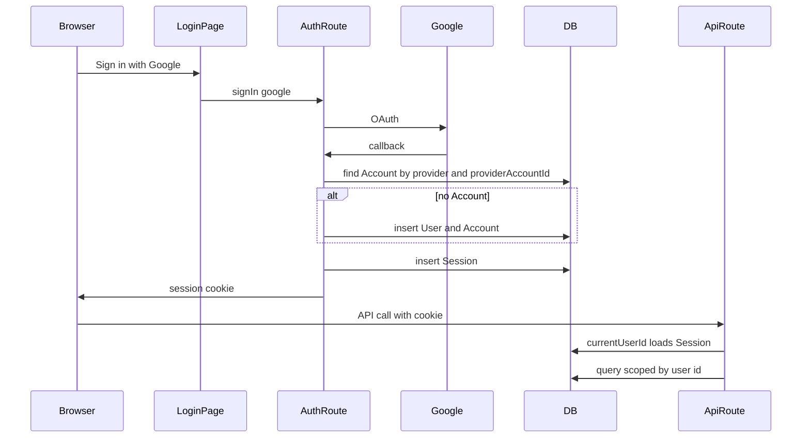

# Google Auth.js sessions

Replace the dev identity stub with Auth.js v5 database sessions and Google sign-in inside the Next app.

Email magic link is not in this branch. No second provider, no mailer, and `allowDangerousEmailAccountLinking` is never set. `VerificationToken` is still created because the Auth.js Prisma adapter schema includes it; Google sign-in does not write a row there. The Google-only lines in the phase docs stay as they are.

Work lands on `cloud/identity`.

## Behavior

`currentUserId()` calls Auth.js `auth()`, reads the database `Session`, and returns `session.user.id`. No session throws, so existing route `catch` blocks still return `401` `{ error: { code: "unauthorized", message: "A signed-in user is required" } }`. Call sites stay `const userId = await currentUserId()`. Integration tests keep mocking `@project/auth`.

First Google sign-in inserts `User` (name, email, image from the profile) and `Account` with `provider = "google"` and Google’s account id as `providerAccountId`. The next sign-in with that pair loads the same user. A different Google account creates a different user. Same email does not merge accounts.

Unlink deletes that user’s `Account` where `provider = "google"`. `User`, `Session`, captures, and favorites stay. After unlink, a later sign-in with the same Google account does not find the old user, because the pair is gone and there is no `google_id` on `User`. The done-when check is the still-signed-in session: captures remain on screen.

Public paths: `/` (landing), `/login`, `/api/health`, `/api/auth/*`. Any other page with no session cookie redirects to `/login`. Any other API call with no session returns 401. A present but unknown or expired token still fails in `currentUserId()` on the Node handler.

`/` stays the landing and the signed-in app. Signed out, it shows a link to `/login` and does not call `currentUserId()`. Signed in, it keeps the current preferences UI and adds sign-out and unlink. No new app route.

Local and production use the same Google client path. `x-user-id`, `DEV_USER_ID`, and `ALLOW_DEV_IDENTITY` leave the code. `.env` is not edited. Live redirect URI and Container Apps copies of the three secrets stay on the hosting track. Doc edits are only the list under Docs.

## Where Auth.js lives

The NextAuth instance lives in [`packages/auth`](../../../packages/auth) and is mounted by the Next app. That is what “inside the Next app” means here: the callback is `http://localhost:3000/api/auth/callback/google` on this server, not a separate identity provider. The config cannot live only under `apps/web`, because [`packages/auth`](../../../packages/auth) must call `auth()` and packages cannot import an app.

New dependencies, both on `@project/auth`: `next-auth` 5 (Auth.js) and `@auth/prisma-adapter`. The adapter is what reads and writes `Account`, `Session`, and `VerificationToken`. Add `@prisma/client` `6.19.3` on that package only if pnpm’s peer check requires it. No other libraries.

## Schema

Append [`packages/db/prisma/migrations/0002_auth.sql`](../../../packages/db/prisma/migrations/0002_auth.sql). Do not edit `0001_init.sql`. Update [`packages/db/prisma/schema.prisma`](../../../packages/db/prisma/schema.prisma) to match. Prisma field names stay the ones `@auth/prisma-adapter` queries. CamelCase fields get `@map` to snake columns, same as `User`. Adapter token fields stay snake_case Prisma names (`refresh_token`, `access_token`, `expires_at`, `token_type`, `scope`, `id_token`, `session_state`) so the adapter’s writes hit those columns.

- `Account`: `userId` → `User`, `type`, `provider`, `providerAccountId`, token fields. `@@unique([provider, providerAccountId])`. `onDelete: Cascade` on the user relation (deleting a user removes accounts; deleting an account does not delete the user).
- `Session`: `sessionToken` unique, `userId`, `expires`. Same cascade from `User`.
- `VerificationToken`: `identifier`, `token`, `expires`, `@@unique([identifier, token])`. No user foreign key.
- `User` gains `accounts` and `sessions` relations only. No `password`, no `google_id`.

## Auth package

Replace [`packages/auth/src/current-user.ts`](../../../packages/auth/src/current-user.ts). Add an Auth.js module that exports `handlers`, `auth`, `signIn`, and `signOut`.

- `session: { strategy: "database" }`, `adapter: PrismaAdapter(prisma)` using the existing client from `@project/db`.
- One provider: Google, env `AUTH_GOOGLE_ID` and `AUTH_GOOGLE_SECRET`. Default scopes only (`openid`, `email`, `profile`). Do not set `allowDangerousEmailAccountLinking`.
- Session callback copies `user.id` onto `session.user`. `AUTH_SECRET` is the cookie secret. Do not require `AUTH_URL` for localhost.
- `unlinkGoogleAccount(userId)` runs `account.deleteMany({ where: { userId, provider: "google" } })` and reports whether a row was deleted. It does not touch `User`, `Session`, `Capture`, or `Favorite`.

## Web app

- [`apps/web/app/api/auth/[...nextauth]/route.ts`](../../../apps/web/app/api/auth/[...nextauth]/route.ts) re-exports `handlers`.
- [`apps/web/app/login/page.tsx`](../../../apps/web/app/login/page.tsx): Google button via a server action `signIn("google")`. Already signed in redirects to `/`.
- [`apps/web/app/api/account/google/route.ts`](../../../apps/web/app/api/account/google/route.ts): `DELETE` calls `currentUserId()`, then unlink. `204` when a row was deleted, `404` when none. This path is not under `/api/auth`, so it is not public.
- [`apps/web/middleware.ts`](../../../apps/web/middleware.ts) does not import `@project/auth` or Prisma. Edge middleware cannot open the Postgres driver. It only looks for the Auth.js session cookie (`authjs.session-token` or `__Secure-authjs.session-token`). Missing cookie on a non-public page redirects to `/login`. Missing cookie on a non-public API returns the 401 error shape. Cookie present continues; the Node handler still checks the session row.
- Signed-in home: sign out (`signOut`) and an unlink button that calls `DELETE /api/account/google`.
- [`apps/migrate/src/seed.ts`](../../../apps/migrate/src/seed.ts): remove the `demo-user` upsert only. Catalog rows stay. A seeded user has no `Account`, and nothing should sign in as that id anymore.

Existing API routes keep their `currentUserId()` try/catch. Do not rewrite capture or preference handlers.

## Docs

Same PR, and only these:

- Rewrite [`docs/specs/auth.md`](../auth.md) in the present tense. Auth.js database sessions, Google only, `currentUserId()` reads the session, and `x-user-id` and `ALLOW_DEV_IDENTITY` are gone. Public routes, first sign-in, and unlink stay in that spec. Verify names the two-account localhost drill, the unlink drill, a cookie-less `curl` of `/api/captures` (401) and `/api/health` (200).
- In [`docs/specs/phases/cloud-phase.md`](../phases/cloud-phase.md), remove only the sentence that `auth.md` still says GitHub. Leave the Google-only decision row and the rest of that file.
- Update [`docs/specs/seams.md`](../seams.md) so identity is the Google session locally and in production, with no `ALLOW_DEV_IDENTITY` switch. The identity row is no longer a header stand-in versus a future swap.
- Update [`packages/auth/README.md`](../../../packages/auth/README.md) so `currentUserId()` is the session lookup.
- Add `AUTH_GOOGLE_ID`, `AUTH_GOOGLE_SECRET`, and `AUTH_SECRET` to [`.env.example`](../../../.env.example), names only. No values. Drop the `DEV_USER_ID` knob in that file.
- Update the “dev identity stub” pointers in [`docs/specs/README.md`](../README.md), [`docs/specs/monorepo.md`](../monorepo.md), [`docs/README.md`](../../README.md), [`README.md`](../../../README.md), [`apps/web/README.md`](../../../apps/web/README.md), [`docs/specs/web.md`](../web.md), [`docs/specs/capture/upload.md`](../capture/upload.md), and [`docs/specs/capture/read.md`](../capture/read.md).

Do not edit [`docs/adr/0003-dev-identity-stub.md`](../../adr/0003-dev-identity-stub.md). Do not edit [`docs/specs/phases/development-phases.md`](../phases/development-phases.md) or [`docs/specs/phases/data-model.md`](../phases/data-model.md). Do not add an ADR. Do not edit `favorites.md` or the migrate README.

## Tests

New [`tests/integration/auth-account.test.ts`](../../../tests/integration/auth-account.test.ts), with `currentUserId` mocked the same way as the capture tests:

- Unlink removes the Google `Account` and leaves `User`, `Capture`, and `Favorite`.
- A second `Account` with the same `(provider, providerAccountId)` fails the unique constraint. A different `providerAccountId` is a different user.

Existing mocked route tests stay as they are. `pnpm test`, `pnpm typecheck`, and `pnpm build` must pass without a Google round-trip. The two-account browser drill is manual, after `pnpm dev`, using the client already in `.env`.

## Checklist

- Add `Account`, `Session`, and `VerificationToken` to `schema.prisma` and `0002_auth.sql`. `User` relations only; no `password` or `google_id`.
- Auth.js v5 in `packages/auth`: database sessions, Google provider, `currentUserId()` from `auth()`, `unlinkGoogleAccount()`.
- Mount `/api/auth`, `/login`, `DELETE /api/account/google`, cookie middleware, and signed-in/out home. Remove the demo-user seed.
- Remove `x-user-id`, `DEV_USER_ID`, and `ALLOW_DEV_IDENTITY` from code. `.env.example` drops `DEV_USER_ID` and lists the three `AUTH_` names only.
- Rewrite `auth.md`. Drop the GitHub sentence in `cloud-phase.md`. Point seams, READMEs, and the named stub pointers at the Google session. No ADR-0003, `development-phases`, or `data-model` edits.
- Integration test for unlink and the `Account` unique pair. Existing `currentUserId` mocks stay.
